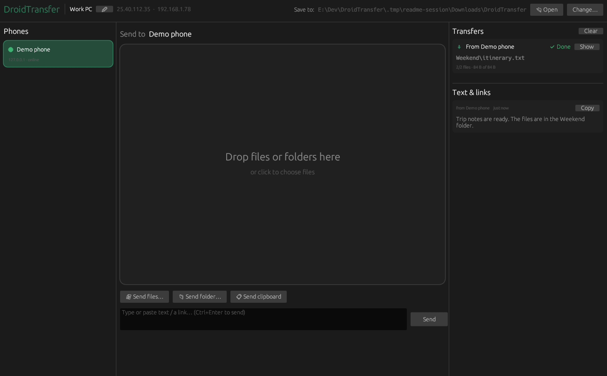
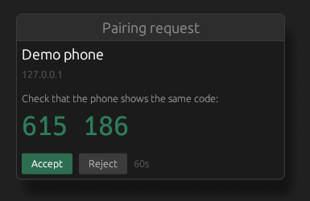

# Filink

Send files, folders, and text between an Android phone and a Windows PC on the same Wi-Fi. Transfers go directly between the two devices, with no account or cloud service.

The apps currently appear as **DroidTransfer** in their windows, the Android share sheet, and build outputs.



*Windows app after receiving two files and a message. Screenshots use a local protocol test client named “Demo phone”.*

## What you can send

- **Files and folders**, in either direction. Drop them onto the PC window or use the file and folder pickers. Transfers show progress and speed, and can be cancelled.
- **Text and links**, typed into the app or sent from the clipboard. Received text stays in the app's history with a Copy button; on Windows it also goes to the clipboard.
- **Android shares**, through **Share → DroidTransfer** in other apps.

Nearby devices are discovered automatically. Pair once by checking a six-digit code and accepting on the PC. The phone can optionally keep receiving in the background through a foreground service.

## Build

### Windows

Install Rust with the MSVC toolchain and the Visual Studio C++ build tools, then run from the repository root:

```powershell
cd pc
cargo build --release
```

Run `pc/target/release/droidtransfer.exe`. The desktop app uses Rust and egui; the release executable is about 3 MB and needs no separate app runtime.

### Android

Requires Android 10 or newer to run. To build, use JDK 17 or newer, Android SDK Platform 35, and Build Tools 35.0.0. The Gradle wrapper is included.

Before the first build:

1. Create `android/local.properties` with your SDK location, using forward slashes, for example:

   ```properties
   sdk.dir=C:/Users/you/AppData/Local/Android/Sdk
   ```

2. In `android/app/build.gradle.kts`, remove the `signingConfigs.getByName("debug") { storeFile = ... }` line pointing to `E:/Android/home/debug.keystore`. This lets Gradle use the default debug keystore.
3. In `android/gradle.properties`, remove `-Djava.io.tmpdir=E:/Android/home/tmp` from `org.gradle.jvmargs`, or replace it with an existing directory on your machine.

From the repository root:

```powershell
cd android
.\gradlew.bat :app:assembleRelease
```

Install `android/app/build/outputs/apk/release/app-release.apk` on your phone. The current release build uses debug signing; it is not configured for store distribution. The app uses Kotlin and Android framework APIs, without AndroidX; the release APK is about 125 KB.

On macOS or Linux, use `./gradlew` in place of `.\gradlew.bat` to build the Android app.

## Pair and transfer

1. Connect the phone and PC to the same Wi-Fi and open both apps. Allow the Windows app through the firewall on **Private networks** when prompted.
2. On the phone, tap **Pair** next to your PC.
3. Check that both devices show the same code, then click **Accept** on the PC.

   

4. Select the paired device and send a file, folder, or some text. On the PC, you can drag files and folders straight from Explorer into the drop area.
5. Enable **Receive in background** on Android if you want the phone to accept transfers while its main screen is closed. Allow notifications for background status and received-text actions.

Received files are saved to:

| Device | Location |
| --- | --- |
| Windows | `%USERPROFILE%\Downloads\DroidTransfer` by default; use **Change…** to choose another folder |
| Android | `Download/DroidTransfer` |

Folder structure is preserved. Existing files are kept: a duplicate name gets a numbered suffix, such as `photo (1).jpg`. Empty folders are not transferred.

## If a device doesn't appear

Keep both apps open while pairing and check that both devices are on the same local network. Guest Wi-Fi and access-point isolation can prevent devices from reaching each other.

Discovery uses **UDP 47820**. Transfers use **TCP 47821** on the PC and **TCP 47822** on the phone. Check the Windows firewall rule if discovery or transfers are blocked.

## Security

Paired devices authenticate each connection with mutual HMAC-SHA256. **The protocol does not encrypt file contents or text.** Use it on a trusted local network; Wi-Fi encryption does not provide end-to-end protection between the apps.

The framing, pairing exchange, and transfer rules are documented in [PROTOCOL.md](PROTOCOL.md).

## Development

`pc/` contains the Rust transfer core and egui desktop interface. `android/` contains the Kotlin app, share target, and receiving service.

Run the existing tests from the repository root:

```powershell
cargo test --manifest-path pc/Cargo.toml
cd android
.\gradlew.bat :app:testDebugUnitTest
```
